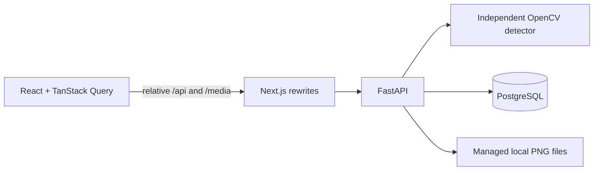

# Architecture and API



Next.js owns layouts, navigation, forms, previews, normalized ROI interaction and server-state fetching. App Router layouts/pages are Server Components; interactive workflows are Client Components. No Next.js route handler overlaps `/api`, and no database driver or database credential exists in the frontend. System fonts and local assets avoid runtime CDNs.

## Data and transactions

The five principal tables are Stores, Shelves, ImageAssets, Analyses and Alerts. The frozen Alembic migration defines foreign keys, valid state/occupancy checks, `(store_id, identifier)` uniqueness, recent-history indexes and a PostgreSQL partial unique index on `alerts(shelf_id) WHERE state IN ('Open','Acknowledged')`. Composite foreign keys require each analysis image, shelf current reference/reading, and alert triggering analysis to belong to the same shelf.

An upload is byte-limited and decoded. The backend snapshots calibration in a short read transaction, closes it, processes the image, and writes generated-name PNG files. It then locks the shelf row, checks that the calibration version still matches, and commits image metadata, analysis, latest reading, diagnostics and alerts in one short transaction. Related metadata is flushed in dependency order. Competing analyses/staff actions serialize on the shelf row. A changed calibration returns 409 and cleans up generated files. Processing/persistence errors clean up new files; historical assets are never overwritten.

File storage and PostgreSQL do not share a transactional filesystem. Handled exceptions remove new files; an abrupt process/OS crash between file creation and commit can leave an unreferenced file. Keep both the media directory and database backed up together. The prototype does not include a crash-orphan collection daemon.

PostgreSQL stores timezone-aware timestamps; Python writes UTC and the browser displays local time. Fresh sessions, pool reconnects and process restarts use saved state. Dashboard totals and filters use the active seeded Store. The live dashboard is queried without browser fetch caching; all mutations invalidate shelf, dashboard, history and alert query caches. Focus/30-second refetch keeps another browser's activity visible.

## Alert state machine

Placement review is a separate current-analysis finding. It adds dashboard attention
even when stock is Full, but does not acknowledge, open, or resolve a restocking
task. Stock classification still owns that workflow. Review/setup failures preserve
the previous valid stock and placement findings. A correctly arranged expected
reference is required before appearance comparison is enabled.

- Valid Low/Empty creates an Open task if no active task exists; otherwise updates severity, latest triggering analysis and last detection time on that same task.
- Acknowledge changes only workflow state, retaining urgency and measured status.
- Report restocked resolves the task with `Staff reported restocked`, records the timestamp, and marks the shelf Awaiting verification. The measurement stays unchanged.
- A subsequent Low/Empty creates a new episode and clears the waiting marker because the new photo verified a remaining shortage.
- A valid Full resolves any active task with `Verified full` and clears Awaiting verification.
- Missing setup, review and decoding errors do not alter alerts.
- Recalibration retains historical tasks; a new valid analysis is required to resolve/update them.

## REST contract

All routes live in FastAPI. Responses use Pydantic schemas, return managed `/media/<generated-id>.png` URLs, and never expose filesystem paths.

| Method and path | Payload / response |
| --- | --- |
| GET `/api/health` | API and PostgreSQL readiness; 503 if database unavailable |
| GET `/api/store` | Active seeded store |
| GET `/api/dashboard` | Total, Full/Low/Empty, unavailable count, urgency-sorted attention zones |
| GET `/api/shelves?search=&status=&aisle=` | Store-scoped shelves; `Unavailable` selects zones without a valid current reading |
| POST `/api/shelves` | JSON: identifier, name, location, optional category; returns created shelf |
| GET `/api/shelves/{id}` | Calibration, current/last analysis, last attempt diagnostic, active task, awaiting-verification state |
| POST `/api/shelves/{id}/calibration` | Multipart `file` and JSON-string `config` containing `roi` and `settings`; returns shelf |
| POST `/api/shelves/{id}/placement` | Multipart full-shelf `file`, JSON-string `config` and integer `calibration_version`; saves expected layout and settings |
| DELETE `/api/shelves/{id}/placement` | Disables placement comparison, preserving historical references |
| POST `/api/shelves/{id}/demo-placement` | JSON `calibration_version`; explicitly enables the bundled expected layout on a demo shelf |
| POST `/api/shelves/{id}/analyses` | Multipart `file`; returns saved analysis, including nullable result for setup/review |
| GET `/api/shelves/{id}/analyses?limit=50` | Newest-first history; limit 1–200 |
| GET `/api/images/{id}` | Image metadata and relative URL |
| GET `/api/alerts?state=Open` | Active/historical alerts, newest detection first; optional exact state filter |
| PATCH `/api/alerts/{id}` | JSON `{"action":"acknowledge"}` or `{"action":"report_restocked"}` |
| POST `/api/shelves/{id}/demo-analysis` | JSON `{"sample":"full"}`; allowlist: full, low, empty, mismatched, misplaced; only demo shelves |

Shelf responses include `placement_reference` and validated `placement_settings`.
Analysis responses include the immutable `placement_reference`, nullable
`placement_result` (status, mismatch ratio, compared area, reason, algorithm version),
and settings in the snapshot. Historical analyses before feature setup return null.
Dashboard `placement_review` counts current placement findings independently of
stock totals; `attention` includes Full shelves with placement findings. Shelf
filter `status=Placement review` selects those findings.

Migration `0002` adds the expected-reference columns and same-shelf ownership
constraints, analysis evidence, and `ingestion_receipts`. Receipt primary keys are
`(shelf_id, calibration_version, digest)`. The receipt and analysis commit together
under the shelf lock; duplicate concurrent publications clean up their newly written
files and return the existing analysis. A receipt never points to another shelf's
analysis. Seed/reset behavior remains ownership aware and deletes receipts only
when explicitly resetting a demo-owned shelf.

The explicit `shelfsense watch` worker ingests stable images from shelf-identifier
subfolders through the same service. There is no watcher in the API process and no
new asynchronous task or dependency. It rechecks calibration before publication,
retains source images, logs failure diagnostics, and resumes after service failures.
Successful receipts survive worker restart. Invalid bytes are logged once for an
unchanged file in a worker session; modification or restart permits retry. The
source filesystem and database are separate: receipts give publication deduplication,
not a guarantee that a producer has finished writing. Atomic rename is recommended.

Calibration example:

```sh
curl -X POST http://127.0.0.1:3000/api/shelves/SHELF_UUID/calibration \
  -F 'file=@assets/demo/zone-01/reference.png' \
  -F 'config={"roi":{"x":0.05,"y":0.1,"width":0.9,"height":0.8},"settings":{"empty_threshold":0.15,"full_threshold":0.60}}'
```

Unspecified detector settings receive validated defaults. The form does not mix a JSON request body with multipart uploads. Invalid schema/ROI/image errors use 422; oversize file uses 413; missing shelf/image/task uses 404; unique conflicts, closed-task actions and changed calibration use 409; unavailable PostgreSQL or unseeded store uses 503. Browser proxy/network errors provide a start-the-API message. A successful decode with unreliable analysis returns 201 with the persisted review/setup outcome, no stock classification, warnings and input image.

The synchronous routes run in FastAPI's worker thread pool. OpenCV CPU work does not block an async event loop. The web proxy's 12 MB allowance accommodates multipart overhead; the backend reads at most 10 MiB + 1 file bytes before rejecting. Pillow checks the decoded dimensions before full decode. Media serving is rooted exclusively at `MEDIA_DIR` and request filenames never become storage paths.

## Framework references

The implementation follows [Next.js rewrites](https://nextjs.org/docs/app/api-reference/config/next-config-js/rewrites), [Next.js proxy body-size configuration](https://nextjs.org/docs/app/api-reference/config/next-config-js/proxyClientMaxBodySize), and [Tailwind's PostCSS installation](https://tailwindcss.com/docs/installation/using-postcss). Installed package types and the production build were used to verify version-specific APIs.
